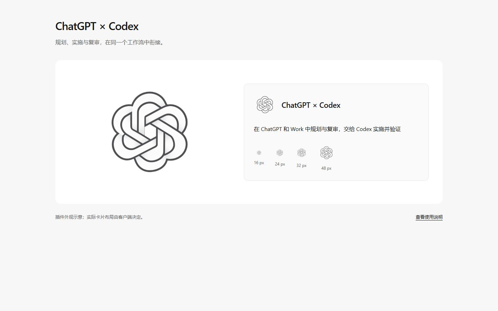

# ChatGPT × Codex · 白色融合标识

以 ChatGPT 的连续编织结构为主体，融合 Codex 图标的云形轮廓。白色主体、中性灰边缘与透明背景组成单一标识。

| 元素 | 内容 |
|---|---|
| 名称 | ChatGPT × Codex |
| 简介 | 在 ChatGPT 和 Work 中规划与复审，交给 Codex 实施并验证 |
| 强调色 | 浅色主题 `#525252`，深色主题 `#E5E5E5` |
| 图标 | 透明 PNG，400 px 与 512 px |
| 调用名 | `$chatgpt-planner-work-codex` |

[浏览器预览](../../ui-preview.html)用于检查白色布局及图标尺寸，并不是原生客户端截图。插件只提供展示元数据，实际卡片布局和客户端缓存由宿主控制。

[生成来源与最终提示词](source.json) · [视觉检查](design-notes.md) · [浏览器检查摘要](inspection.json) · [Codex 实际读取结果](metadata.json) · [技能元数据](../../skills/chatgpt-planner-work-codex/agents/openai.yaml)

配置使用 [OpenAI 官方技能字段](https://learn.chatgpt.com/docs/build-skills) 和 [插件元数据](https://developers.openai.com/plugins/build/plugins)。品牌元素与非官方定制说明见 [NOTICE](../../NOTICE.md)。
